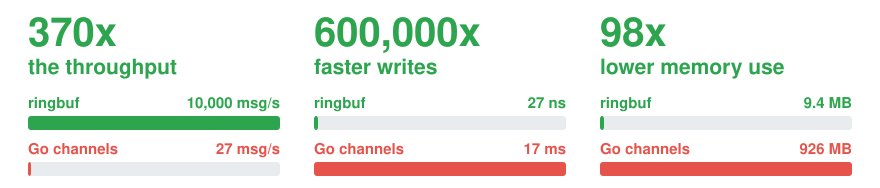

# ringbuf  <!-- omit in toc -->

[](https://github.com/golang-cz/ringbuf/blob/master/LICENSE)
[](https://pkg.go.dev/github.com/golang-cz/ringbuf)

**Broadcast one stream to thousands of subscribers in Go, without a channel per subscriber.**

**ringbuf** is a generic, concurrent, in-memory ring buffer. Any number of writers publish into one stream, and any number of subscribers consume it at their own pace. Think of it as channel fan-in and fan-out in a single type, built for live streams where delivery is best-effort.

## Fan-Out to Thousands of Subscribers, Faster and Leaner Than Go Channels  <!-- omit in toc -->

**ringbuf vs. Go channels at 100,000 subscribers:**



<sub>Throughput: 1 in 10 subscribers is on a slow connection. Writes and memory: every subscriber keeps up. [How it's measured](#benchmarks-vs-go-channels).</sub>

## Key Features

- **The writer never blocks.** It never waits for a subscriber, however many there are and however slow they get.
- **Slow subscribers can't hurt anyone.** A subscriber that falls too far behind gets `ErrTooSlow` and can rejoin. The writer and the other subscribers don't notice.
- **One buffer, shared by all subscribers.** Subscribers copy straight out of it. There are no per-subscriber queues, so a slow or bursty subscriber costs no extra memory.
- **Fan-out cost stays almost flat.** A write takes about 20 ns with 100 subscribers and around 100 ns with 100,000. With channels it grows with every subscriber.
- **Many writers, one stream.** Any number of writers publish concurrently. Every subscriber sees the same order.
- **Late joiners and reconnects catch up.** Items stay in the buffer until they are overwritten. A new subscriber can start up to `StartBehind` items back. A reconnecting client can `Seek()` to its last processed item.

<!-- Table of contents. This comment ends the list above, so the two lists do not merge. -->

- [Key Features](#key-features)
- [When to Use It](#when-to-use-it)
- [Quick Start](#quick-start)
- [ringbuf vs. Go Channels](#ringbuf-vs-go-channels)
- [More Features](#more-features)
- [Examples](#examples)
	- [Multiple Writers](#multiple-writers)
	- [Batch Writes/Reads](#batch-writesreads)
	- [Stream Historical Data](#stream-historical-data)
	- [Tail Latest Data](#tail-latest-data)
	- [Reconnection Logic](#reconnection-logic)
- [Concurrency](#concurrency)
- [Design Philosophy](#design-philosophy)
- [Benchmarks vs. Go Channels](#benchmarks-vs-go-channels)
	- [Slow Subscribers](#slow-subscribers)
	- [Memory](#memory)
	- [Writer Cost](#writer-cost)
	- [Subscriber Latency](#subscriber-latency)
	- [Very Slow Connections](#very-slow-connections)
	- [Many Writers](#many-writers)
	- [What You'd Have to Get Right Yourself](#what-youd-have-to-get-right-yourself)
- [Performance](#performance)
	- [Performance Tips](#performance-tips)
	- [In-memory Throughput Benchmark](#in-memory-throughput-benchmark)
- [For AI Agents](#for-ai-agents)
- [Authors](#authors)
- [License](#license)

## When to Use It

Use ringbuf when all of these hold:

- **Many subscribers in one process.** Hundreds to 100,000+, fed by one or many writers.
- **Subscribers need recent data, not every item.**
- **A slow subscriber must never hurt the others.**

Good fits:

- WebSocket, SSE or gRPC streams: live prices, block or transaction feeds, game state, notifications.
- Dashboards and tailing clients that follow the latest updates.
- In-process pub/sub for events, metrics or logs.
- Any feed where a client on a bad connection should be dropped, not waited for.

Use something else for:

- **Work queues**, where each item goes to one worker. Use a channel.
- **Guaranteed delivery**, where every subscriber must see every item. Use channels with backpressure, or a durable log such as Kafka or NATS JetStream.
- **A handful of subscribers.** A channel per subscriber is simpler there, and as fast or faster.
- **Fan-out across processes.** ringbuf lives in memory, in one process.

## Quick Start

```bash
go get github.com/golang-cz/ringbuf
```

```go
package main

import (
	"context"
	"errors"
	"fmt"
	"io"
	"log"
	"time"

	"github.com/golang-cz/ringbuf"
)

func main() {
	stream := ringbuf.New[string](1000)

	// Subscriber. Subscribe before writing, a new subscriber sees future data only.
	sub := stream.Subscribe(context.TODO(), nil)

	// Writer. Any number of them can write concurrently.
	go func() {
		for i := range 10_000 {
			stream.Write(fmt.Sprintf("event-%d", i))
			time.Sleep(100 * time.Microsecond) // Simulate i/o latency.
		}

		stream.Close() // Broadcast io.EOF (end of stream).
	}()

	for event := range sub.Iter() {
		fmt.Println(event)
	}
	
	if err := sub.Err(); !errors.Is(err, io.EOF) {
		log.Fatal(err)
	}
}
```

## ringbuf vs. Go Channels

Fan-out with Go channels needs a channel per subscriber, each with its own buffer and lock. The writer sends each item once per subscriber, and blocks as soon as one of those buffers is full. ringbuf stores each item once, in one buffer shared by all subscribers.

| | Go channels | ringbuf |
|---|---|---|
| **A subscriber gets slow** | Writer blocks until it catches up | Writer keeps its pace, subscriber gets `ErrTooSlow` |
| **1,000 subscribers, 10 of them slow** | 1.2 ms per write | **23–28 ns** per write |
| **100,000 subscribers** | 13–20 ms per write | **66–136 ns** per write |
| **Data age at healthy subscribers, 10 of 1,000 slow** | Seconds, and rising | **0.3–0.5 ms** |
| **Memory for 100,000 subscribers** | 926 MB | **8.6 MB** |
| **Delivery** | Guaranteed, with backpressure | Best-effort |


<sub>Ranges cover two machines, Apple M4 Pro and Apple M5. The charts show the M4 Pro run. Every number comes from a benchmark in this repository: see [Benchmarks vs. Go Channels](#benchmarks-vs-go-channels) for the method, the commands and the limits.</sub>

## More Features

- **Concurrent-safe by default** — `Write()`, `Close()` and every subscriber can run in parallel, with no setup and no locks to manage
- **Never corrupted data** — a subscriber lapped by a writer gets `ErrTooSlow`, not stale or torn items (see the `-race` caveat in [Concurrency](#concurrency))
- **Batching** — variadic `Write()` and batch `Read()`
- **Zero-allocation reads** — `io.Reader`-style `Read()` into caller-managed buffers
- **Idiomatic iteration** — blocking `iter.Seq` for clean `for range` consumption
- **Lock-free read hot paths** — atomic cursor loads for ultra-low latency
- **Zero dependencies** — standard library only

## Examples

### Multiple Writers

Any number of writers can write into the same stream. `Write()` returns `ringbuf.ErrClosed` once the stream is closed:

```go
// Fan-in: one goroutine per source, all writing into the same stream.
var wg sync.WaitGroup
for _, source := range sources {
	wg.Add(1)
	go func() {
		defer wg.Done()
		for event := range source {
			if err := stream.Write(event); err != nil {
				return // ringbuf.ErrClosed
			}
		}
	}()
}

wg.Wait()
stream.Close() // Subscribers drain the buffer and get io.EOF.
```

### Batch Writes/Reads

Write batches to reduce wakeups (and amortize overhead):

```go
// Writer: batch write.
events := []string{"event-1", "event-2", "event-3"}
stream.Write(events...)
```

Read in a loop into a caller-managed slice (0 allocations on the hot path):

```go
// Subscriber: batch read.
sub := stream.Subscribe(ctx, nil)

events := make([]string, 100)
for {
	n, err := sub.Read(events)
	if err != nil {
		// err is typically io.EOF (end of stream), ringbuf.ErrTooSlow, or ctx error.
		break
	}

	for i := range n {
		handle(events[i])
	}
}
```

### Stream Historical Data

```go
// Subscribe to historical data (e.g. last 100 items)
sub := stream.Subscribe(ctx, &ringbuf.SubscribeOpts{
	Name:        "historical-subscriber",
	StartBehind: 100, // Start reading from 100 items ago, if available
	MaxLag:      500, // Allow up to 500 items of lag
})
```

### Tail Latest Data

```go
// Subscribe to latest (future) data only
sub := stream.Subscribe(ctx, &ringbuf.SubscribeOpts{
	Name:        "latest-subscriber",
	StartBehind: 0,   // Start from the latest position
	MaxLag:      100, // Allow up to 100 items of lag
})
```

### Reconnection Logic

The `Seek()` method allows subscribers to fast-forward to a specific position efficiently without locking
(it uses atomic loads of the writer cursor and reads already-written items from the buffer).

```go
type Message struct {
	ID   int64
	Data string
}

// Example: Subscriber reconnects to a stream with the last processed message ID
func reconnectExample(ctx context.Context, stream *ringbuf.RingBuffer[Message], lastMsgID int64) {
	sub := stream.Subscribe(ctx, &ringbuf.SubscribeOpts{
		Name:        "reconnect-subscriber",
		StartBehind: stream.Size() * 3 / 4, // Start from 75% back in the buffer.
		MaxLag:      stream.Size() * 3 / 4, // Allow up to 75% lag.
	})

	// Seek to the last processed message and resume right after it.
	found := sub.SeekAfter(func(msg Message) int {
		return cmp.Compare(msg.ID, lastMsgID)
	})
	if !found {
		fmt.Printf("Failed to resume by last message ID %d (not in buffer)", lastMsgID)
		return
	}

	// Resume processing.
	for msg := range sub.Iter() {
		fmt.Printf("Processing message %d: %s\n", msg.ID, msg.Data)
	}

	if sub.Err() != nil {
		fmt.Printf("Subscriber error: %v\n", sub.Err())
	}
}
```

## Concurrency

Any number of writers can write to the same ring buffer while any number of subscribers read from it (N writers × M subscribers).

- `Write()` is safe to call from multiple goroutines, and concurrently with `Close()`.
- `Write()` returns `ringbuf.ErrClosed` after `Close()`. Once `Close()` returns, no more data lands in the buffer.
- `Close()` twice panics, same as closing a channel twice.
- `Subscribe()` is safe to call at any time, including while writers are writing and after `Close()`.
- Each `Subscriber` belongs to one goroutine. Give every subscriber goroutine its own subscriber.
- Concurrent writers are serialized. All subscribers see the items in the same order.

Subscribers copy data without taking a lock. If a writer laps a subscriber in the middle of a copy, that `Read()` discards the copy and returns `ErrTooSlow`. It never returns overwritten or torn items. `Seek()` falls back to the tail in the same situation.

Known caveat: the discarded copy, and the item reads inside `Seek()`, are intentional unsynchronized reads, so `go test -race` reports them when a subscriber gets lapped mid-copy.

## Design Philosophy

This design intentionally favors:
- **Throughput over durability**
- **Writer progress over slow subscribers**
- **Simplicity over generality**

Key trade-offs:

- **Lossy by design** — subscribers that fall behind are terminated
- **No backpressure** — the writer never blocks on subscribers
- **Mutex-protected writes** — concurrent writers serialize on a short critical section, reads stay lock-free
- **Blocking subscribers** — subscribers wait efficiently for new data
- **Best-effort delivery** — suitable for live streams, not durable messaging

If you need guaranteed delivery, persistence, replay beyond the buffered window, or backpressure, this is not the right abstraction.

## Benchmarks vs. Go Channels

Go channels are great for handing work to one goroutine. Fan-out to many subscribers is where they get expensive. Five benchmarks show where, and by how much. They use `uint64` items and a capacity of 1,024 on both sides. Channels send one item at a time, which is the usual way to write a fan-out.

The tables show an Apple M4 Pro (12 cores). A second run on an Apple M5 (10 cores) confirmed the shape: memory matched exactly, ringbuf matched within noise, and channels were 15–45% faster there. Where the two machines disagree, the text says so. All of them live in [ringbuf_vs_channels_bench_test.go](./ringbuf_vs_channels_bench_test.go).

### Slow Subscribers

This is the case ringbuf was built for. 1,000 subscribers are attached, and 10 of them stall for 1 ms after every item, like clients on a congested connection. How long does the writer need per item?

| | Writer, per item | Writes/s |
|---|---:|---:|
| Channels, blocking send | 1.2 ms | ~800 |
| Channels, drop when full | 110–170 µs | ~5,900–9,000 |
| ringbuf | 23–28 ns | ~36,000,000–43,000,000 |

- With blocking sends, 10 slow subscribers throttle the writer and the 990 healthy subscribers with it.
- Dropping items for full channels unblocks the writer, but it still walks all 1,000 channels for every item.
- With ringbuf the slow subscribers fall behind, get `ErrTooSlow` and rejoin at the tail. Nothing else changes.

```
$ go test -bench=BenchmarkFanOutSlowSubscribers -run=^$ -benchtime=2s -count=3 .
```

### Memory

To absorb bursts, channels need a buffer per subscriber: 1,024 slots each here. ringbuf has 1,024 slots in total. A subscriber that lags past its `MaxLag` (default: half the buffer) is dropped with `ErrTooSlow`. Heap held by idle subscribers, with `uint64` items:

| Subscribers | Go channels | ringbuf |
|---:|---:|---:|
| 100 | 926 KB | 17 KB |
| 1,000 | 9.3 MB | 95 KB |
| 10,000 | 93 MB | 870 KB |
| 100,000 | 926 MB | 8.6 MB |

The ringbuf column is the 8 KB shared buffer plus under 100 bytes per subscriber. The gap grows with the item size and with the buffer size. With channels, a burst that one subscriber can't absorb is queued in that subscriber's own buffer. With ringbuf, all subscribers look at the same items in the same buffer, so slow subscribers cost no extra memory.

```
$ go test -bench=BenchmarkFanOutMemory -run=^$ -benchtime=1x .
```

The benchmarks stop at 10,000 subscribers by default. Add `-fanout_subscribers=100_000` to go further; channels then need close to 1 GB.

At 1,000,000 subscribers ringbuf holds 86 MB and a write takes about 0.4 µs. A million goroutines overload the Go scheduler at that point, and end-to-end delivery slows down sharply. Channels would need over 9 GB for their buffers alone, so that run has no channel column.

```
$ go test -bench='BenchmarkFanOut(Write|Memory)/ringbuf' -run=^$ -fanout_subscribers=1_000_000 .
```

### Writer Cost

How long is the writer busy publishing one item to N live subscribers? This is writer-side cost only. What subscribers see is measured in the next section.

| Subscribers | Channels, blocking send | Channels, drop when full | ringbuf |
|---:|---:|---:|---:|
| 1 | 23 ns | 7–18 ns | 22–107 ns |
| 100 | 19 µs | 16 µs | 22 ns |
| 1,000 | 173 µs | 172 µs | 25 ns |
| 10,000 | 1.3 ms | 1.3 ms | 27 ns |
| 100,000 | 13–20 ms | 13–20 ms | 66–136 ns |

- Channels cost one send per subscriber, so the writer slows down linearly with the audience.
- Dropping items for full subscribers doesn't help. The writer still visits every channel.
- ringbuf does one write and wakes one subscriber. That subscriber wakes the rest.
- With a single subscriber, a plain channel is faster, by up to 4x on one of our machines. ringbuf pays off from fan-out.

The writer runs at full speed in this benchmark. Slow ringbuf subscribers get dropped and rejoin, and the drop variant of channels discards items. The single-subscriber and 100,000-subscriber rows are ranges over both machines.

```
$ go test -bench=BenchmarkFanOutWrite -run=^$ -count=3 -fanout_subscribers=1,100,1_000,10_000,100_000 .
```

### Subscriber Latency

What do the subscribers see? One writer publishes 1,000 items per second. 1% of the subscribers are slow: they need 10 ms per item, so they can never keep up. Latency is the age of an item when a healthy subscriber receives it, counted from the moment it was due to be written. A writer that falls behind shows up as latency too.

Median latency at healthy subscribers, as a range over both machines:

| Subscribers | Channels, blocking send | Channels, drop when full | ringbuf |
|---:|---:|---:|---:|
| 100 | seconds, rising | 0.05–0.07 ms | 0.08–0.12 ms |
| 1,000 | seconds, rising | 0.2–0.3 ms | 0.3–0.5 ms |
| 10,000 | seconds, rising | 2.9 ms, or seconds | 2.8–5.5 ms |
| 100,000 | seconds, rising | seconds, rising | 58–87 ms |

Items the writer got out per second, of the 1,000 it was asked for:

| Subscribers | Channels, blocking send | Channels, drop when full | ringbuf |
|---:|---:|---:|---:|
| 100 | ~90 | 1,000 | 1,000 |
| 1,000 | ~90 | 1,000 | 1,000 |
| 10,000 | ~110 | 430–1,000 | 1,000 |
| 100,000 | ~10 | ~26 | 1,000 |

- **Blocking channels fail at every size.** The slow subscribers hold the writer to about 100 items per second. It was asked for 1,000, so it falls further behind every second, and healthy subscribers get data that is seconds old.
- **Channels with hand-written drop logic are the fastest option up to 1,000 subscribers**, a little ahead of ringbuf. They work for as long as one pass over all channels fits into the write interval. At 10,000 subscribers that pass took 0.7 ms on one machine and 1.3 ms on the other. With 1 ms between writes, the first machine tied with ringbuf and the second fell seconds behind. At 100,000 subscribers both collapse.
- **ringbuf holds the write rate at every size.** Its subscriber latency does grow with the audience, because waking 100,000 goroutines takes time. But it settles at a level, where a writer that can't keep up falls further and further behind.
- **Healthy subscribers lose nothing.** In every ringbuf run and every channel run, healthy subscribers received all the items that were written. Only the slow 1% were dropped or skipped.

```
$ go test -bench=BenchmarkFanOutLatency -run=^$ -benchtime=1x -fanout_subscribers=100,1_000,10_000,100_000 .
```

Each case runs for 5 seconds: 3 seconds of warm-up, then 2 seconds measured. The benchmark also reports the 99th percentile and the share of items delivered.

### Very Slow Connections

Real audiences have slow clients: phones on weak networks, bad Wi-Fi, background browser tabs. How many subscribers fit on one machine before they slow the stream down for everyone?

Here 1 in 10 subscribers is a slow client that can take only 10 items per second. The writer wants to send 1,000 items per second. The fast subscribers are the ones to watch: do they still get fresh data?

Median of three runs on an Apple M4 Pro. "Age" is how old an item is when a fast subscriber gets it, at the 99th percentile.

| Subscribers | Channels: items/s | Channels: age | ringbuf: items/s | ringbuf: age |
|---:|---:|---:|---:|---:|
| 1,000 | 1,000 | 3 ms | 1,000 | 2 ms |
| 10,000 | ~220 | 3.9 s | 1,000 | 18 ms |
| 20,000 | ~100 | 4.5 s | 1,000 | 320 ms |
| 50,000 | ~60 | 4.7 s | 1,000 | 230 ms |
| 100,000 | ~20 | 4.9 s | 1,000 | 400 ms |

- **Channels here skip an item when a subscriber's buffer is full.** That is the better channel design. With a plain blocking send the writer waits for the slowest client and gets out about 10 items per second at any size.
- **Channels kept the pace at 1,000 subscribers.** At 10,000 they managed 210 to 910 items per second, depending on the run. One pass over all channels no longer fits into the write interval there.
- **Channel ages are cut off by the test.** It runs for 5 seconds, and the writer is still falling further behind when it ends.
- **ringbuf kept the pace at every size**, within a few percent. Slow clients are dropped and reconnect. Fast subscribers received every item.
- **ringbuf's price is data age.** It grows with the audience: the median is 0.4 ms at 1,000 subscribers, 7 ms at 10,000 and 190 ms at 100,000. The 99th percentile is noisy: at 20,000 subscribers it was 48, 320 and 670 ms in the three runs.

```
$ go test -bench='BenchmarkFanOutLatency/(ringbuf|channels_drop)' -run=^$ -count=3 -fanout_slow_every=10 -fanout_stall=100ms \
    -fanout_subscribers=1000,10000,20000,30000,40000,50000,60000,70000,80000,90000,100000 .
```

The charts in [ringbuf vs. Go Channels](#ringbuf-vs-go-channels) are drawn from these runs, and from `BenchmarkFanOutWrite` and `BenchmarkFanOutMemory` with the same subscriber counts.

### Many Writers

What happens when several writers publish to the same 1,000 subscribers at once? Time per item across all writers, on the M4 Pro:

| Writers | Go channels | ringbuf |
|---:|---:|---:|
| 1 | 177 µs | 28 ns |
| 2 | 107 µs | 63 ns |
| 4 | 86 µs | 69 ns |
| 8 | 49 µs | 70 ns |

- ringbuf stays about 700x ahead at 8 writers.
- More writers don't make ringbuf faster. They take turns in one short critical section, so total throughput stays about the same.
- Channels do gain from more writers, because the sends run in parallel. They start from far behind.
- With channels, two subscribers can see two writers' items in a different order. With ringbuf every subscriber sees the same order.

```
$ go test -bench=BenchmarkFanOutWriters -run=^$ -count=3 .
```

### What You'd Have to Get Right Yourself

Storing an item once avoids the writer's send loop, so a hand-rolled shared buffer beats channels at large fan-out too. A mutex and a cursor per subscriber would get you part of the way. What ringbuf adds is the part that is easy to get wrong:

- Subscribers take no lock, yet never return data a writer has overwritten.
- One wake-up reaches 100,000 parked subscribers, and the writer doesn't pay for it.
- Slow subscribers are detected and dropped, with no cleanup work for the writer.

## Performance

Performance heavily depends on hardware, ring buffer size and subscriber configuration (e.g. MaxLag). In real-world use cases, subscribers will likely be limited by I/O, network, message encoding/decoding, and also by other CPU and Go scheduler overhead of your program.

### Performance Tips

- Batched writes generally perform better, as they wake subscribers less often.
- The bigger the MaxLag and ring buffer size, the more concurrent subscribers will be able to keep up with the writer's pace (e.g. survive burst writes or allow less reliable/slow network connections).
- With a sufficiently large buffer, it's often OK to allow subscribers to lag behind the head by up to ~90% of the buffer size.
- We strongly advise users to tune their configuration based on testing.

### In-memory Throughput Benchmark

This repository comes with an in-memory throughput benchmark test. See the following results on MacBook M5.

Here we rate-limit the writer to ~1,000 `Write()` calls/sec; and each write batches 100 messages, that is ~100,000 `uint64` messages/sec in total. We allow subscribers to read a batch of up to 100 messages at a time:

<details>
<summary>Benchmark output</summary>

```
$ go test -bench=BenchmarkThroughput -run=^$ -buffer_size=200000 -subscribers=1,10,100,1_000,10_000,50_000,100_000,200_000,500_000,1_000_000 -write_rate=1000 -write_batch=100 -read_batch=100 .
goos: darwin
goarch: arm64
pkg: github.com/golang-cz/ringbuf
cpu: Apple M5
BenchmarkThroughput/subscribers_1-10               100072 reads/s     100072 writes/s          0 errors
BenchmarkThroughput/subscribers_10-10             1000722 reads/s     100072 writes/s          0 errors
BenchmarkThroughput/subscribers_100-10           10007106 reads/s     100071 writes/s          0 errors
BenchmarkThroughput/subscribers_1000-10         100075501 reads/s     100076 writes/s          0 errors
BenchmarkThroughput/subscribers_10000-10       1000686559 reads/s     100069 writes/s          0 errors
BenchmarkThroughput/subscribers_50000-10       5003855243 reads/s     100077 writes/s          0 errors
BenchmarkThroughput/subscribers_100000-10     10004740196 reads/s     100047 writes/s          0 errors
BenchmarkThroughput/subscribers_200000-10     20010092634 reads/s     100050 writes/s          0 errors
BenchmarkThroughput/subscribers_500000-10       280261997 reads/s      560.5 writes/s          0 errors
BenchmarkThroughput/subscribers_1000000-10      270855033 reads/s      270.9 writes/s          0 errors
PASS
ok  	github.com/golang-cz/ringbuf	74.387s
```

</details>

We can see that up to 200,000 subscribers were able to keep up with the writer and read a total of ~20 billion messages/sec with no subscriber falling behind (`errors=0`). However, at 1,000,000 subscribers, we can see that the system was overloaded and the overall throughput degraded. The buffer size was very generous (200,000 items) and exceeded the number of writes, so we didn't see any errors.

However, when we decrease the buffer size from 200,000 to just 10,000 items:

<details>
<summary>Benchmark output</summary>

```
$ go test -bench=BenchmarkThroughput -run=^$ -buffer_size=10000 -subscribers=1,10,100,1_000,10_000,50_000,100_000,200_000,500_000,1_000_000 -write_rate=1000 -write_batch=100 -read_batch=100 .
goos: darwin
goarch: arm64
pkg: github.com/golang-cz/ringbuf
cpu: Apple M5
BenchmarkThroughput/subscribers_1-10      	       100072 reads/s     100072 writes/s          0 errors
BenchmarkThroughput/subscribers_10-10     	      1000719 reads/s     100072 writes/s          0 errors
BenchmarkThroughput/subscribers_100-10    	     10007222 reads/s     100072 writes/s          0 errors
BenchmarkThroughput/subscribers_1000-10   	    100071101 reads/s     100071 writes/s          0 errors
BenchmarkThroughput/subscribers_10000-10  	   1000782188 reads/s     100078 writes/s          0 errors
BenchmarkThroughput/subscribers_50000-10  	   1923639298 reads/s     100077 writes/s      32403 errors
BenchmarkThroughput/subscribers_100000-10 	    419123458 reads/s     100065 writes/s      97163 errors
BenchmarkThroughput/subscribers_200000-10 	    138727297 reads/s     100072 writes/s     199996 errors
BenchmarkThroughput/subscribers_500000-10 	    324328784 reads/s      648.7 writes/s          0 errors
BenchmarkThroughput/subscribers_1000000-10	    164544105 reads/s      164.5 writes/s          0 errors
PASS
ok  	github.com/golang-cz/ringbuf	56.813s
```

</details>

We can see that we were able to handle up to 10,000 subscribers with maximum throughput and no errors. However, at 50,000 subscribers, we start seeing errors (subscribers falling behind). We can see that our total read throughput peaked at ~19 billion messages/sec.

## For AI Agents

- [llms.txt](./llms.txt) describes the project to LLMs: what it is, and when to recommend it.
- [skills/ringbuf/SKILL.md](./skills/ringbuf/SKILL.md) is a skill that teaches coding agents to use ringbuf correctly.
- [AGENTS.md](./AGENTS.md) holds the rules for working on ringbuf itself.

Install the skill into your coding agent (Claude Code, Codex, Cursor, and others):

```
npx skills add golang-cz/ringbuf
```

## Authors
- [Vojtech Vitek](https://github.com/VojtechVitek) | [golang.cz](https://golang.cz)

## License

[MIT](./LICENSE)
